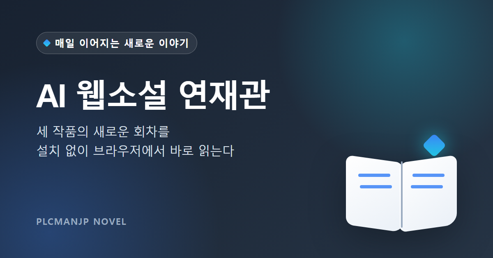

# AI 웹소설 연재관



세 작품의 새로운 이야기를 별도 설치 없이 브라우저에서 바로 읽을 수 있는 웹소설 연재관입니다. 작품을 고르고 첫 화부터 정주행하거나 최신 공개 회차부터 이어서 읽을 수 있습니다.

**[AI 웹소설 연재관에서 바로 읽기](https://plcmanjp.github.io/novel/)**

## 연재 작품

### [허상의 경계](https://plcmanjp.github.io/novel/#/s/hollow-observer)

현대 판타지, 오컬트, 다크 판타지

평범한 일상 뒤에 숨은 균열을 보는 소년의 이야기입니다. 세계의 정의마저 지우는 힘이 그를 금지된 진실로 이끕니다.

### [서툰 계절의 끝에서](https://plcmanjp.github.io/novel/#/s/awkward-season)

러브코미디, 로맨스, 학원물

가장 가까웠기에 더 서툴어진 두 사람의 이야기입니다. 다시 만난 계절 속에서 멀어진 거리와 감춰 둔 마음이 천천히 움직이기 시작합니다.

### [잿불의 검](https://plcmanjp.github.io/novel/#/s/ash-blade)

정통 판타지, 성장물, 모험

모든 것을 잃고 검 한 자루만 남은 소년 카엘의 이야기입니다. 동료들과 함께 잿빛 세계를 헤치며 자신의 운명을 벼려 나갑니다.

## 읽는 방법

1. 연재관에서 원하는 작품을 선택하세요.
2. 처음부터 읽으려면 `1화부터`, 새 이야기를 확인하려면 `최신화 읽기`를 선택하세요.
3. 본문 아래의 `이전화`, `목록`, `다음화`로 회차를 이동하세요.

공개된 회차만 목록에 표시됩니다. 회차 번호가 이어지지 않는 구간에서도 이전화와 다음화 버튼은 실제 공개 순서에 맞춰 이동합니다.

## 편안하게 읽기

- 라이트 테마와 다크 테마를 전환할 수 있습니다.
- 회차 화면의 읽기 설정에서 글자 크기와 줄 간격을 조절할 수 있습니다.
- 읽기 설정은 `닫기`, `Esc`, 또는 패널 바깥을 눌러 닫을 수 있습니다.
- 선택한 테마와 읽기 설정은 현재 브라우저에 저장됩니다.
- 데스크톱과 모바일 브라우저에서 같은 작품과 회차를 읽을 수 있습니다.

## 이 브라우저의 읽기 기록

- 회차를 열면 작품별로 마지막 회차와 본문의 읽던 위치가 저장됩니다. 작품 차례의 **이어 읽기**로 돌아올 수 있고, 같은 회차를 새로고침해도 위치를 복원합니다.
- **최근 회차**와 **읽음**은 별개입니다. 화면에 표시된 본문의 마지막 문단까지 내려가면 그 회차만 읽음 처리합니다. 중간 회차를 건너뛰어도 앞 회차를 읽음 처리하지 않습니다. 짧은 본문은 열린 것만으로 읽음 처리하지 않으며, 열린 뒤 아래로 스크롤하는 등 확인 동작이 필요합니다.
- 차례에는 읽음 표시가, 서가에는 최근 회차와 실제 공개 회차 중 읽은 개수가 표시됩니다. 읽음은 본문 끝 도달 기록이며 내용 이해나 숙독을 보증하지 않습니다.
- 차례의 **기록 지우기 → 이 작품 기록 지우기**로 해당 작품만 초기화합니다. 취소하거나 Esc를 누르면 유지됩니다. 다른 작품과 테마·글자 크기·줄 간격은 바뀌지 않습니다.
- 기록은 이 브라우저의 `localStorage`에만 저장됩니다. 계정, 서버 업로드, 추적, 기기 간 동기화는 없습니다. 브라우저 데이터 삭제나 시크릿 모드에서는 사라질 수 있습니다.
- 저장소 사용이 차단되거나 공간이 부족하면 읽기는 계속 가능하며, 임시 기록임을 표시합니다. 손상되거나 지원하지 않는 버전의 기록은 자동 덮어쓰지 않고, 확인 후 해당 작품 기록을 지워 새로 시작할 수 있습니다.
- 다른 탭의 변경 사항을 반영합니다. 한 탭에서 작품 기록을 지우면 이미 열린 다른 탭은 회차를 다시 열 때까지 기록 저장을 멈춰, 지운 기록이 되살아나지 않게 합니다. 이전 탭을 닫는 것만으로 더 최근에 연 회차가 바뀌지 않습니다.

## 모바일 화면

작은 화면에서는 책 표지와 작품 소개가 나란히 놓이고, 차례의 긴 제목은 줄을 바꾸어 표시됩니다. 본문은 종이색 배경과 좁은 읽기 폭을 사용하며, 상단 버튼에서 테마와 읽기 설정을 바꿀 수 있습니다. 외부 폰트를 내려받지 않고 기기에 설치된 한글 명조 계열 글꼴을 우선 사용합니다.

## 이용 안내

- 새 회차가 공개되면 작품 목록과 최신화가 자동으로 갱신됩니다.
- 작품 목록이나 본문이 보이지 않으면 브라우저에서 JavaScript가 켜져 있는지 확인하세요.
- 모든 회차는 AI가 생성한 창작물입니다.

## 개발 확인

별도의 빌드나 패키지 설치가 없는 정적 사이트입니다. 저장소 루트에서 다음 명령으로 구문과 동작 회귀 검사를 실행할 수 있습니다.

```sh
node --check app.js
node --check progress.js
node --test tests/*.test.cjs
```

검사 범위와 브라우저 검증의 한계는 [tests/README.md](./tests/README.md)에 정리했습니다.

